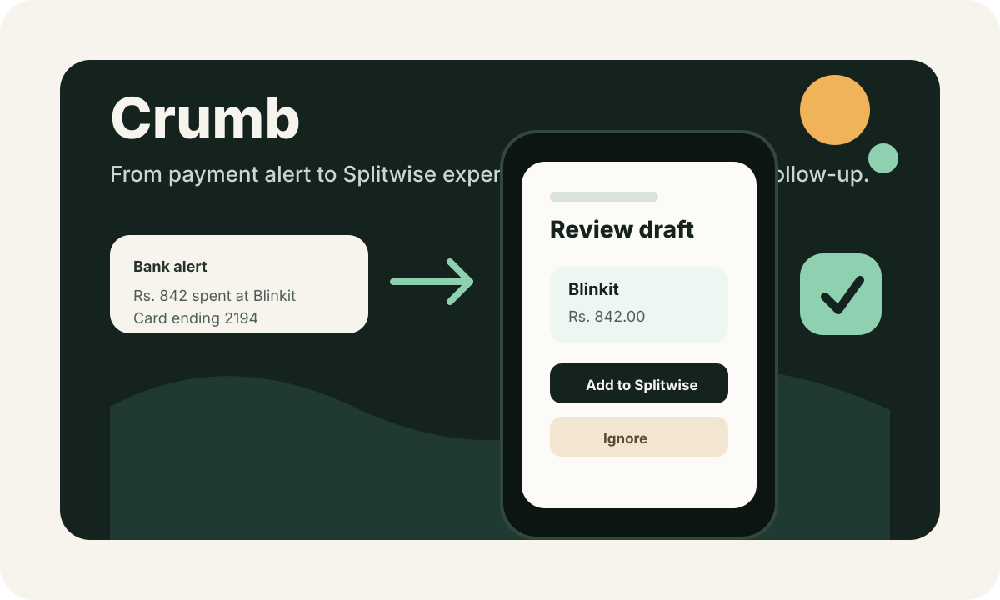
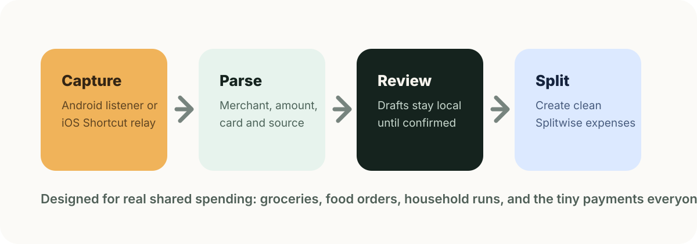

# Crumb

**Crumb catches shared expenses from payment alerts and turns them into reviewed Splitwise drafts.**

Most shared expenses are not missed because people do not care. They are missed because the moment passes: a grocery order arrives, someone pays for dinner, a card notification disappears, and the Splitwise entry never gets made. Crumb closes that gap.



## Why Crumb

Crumb is built for the everyday spending that quietly creates roommate and group-accounting friction:

- groceries ordered from Blinkit, Instamart, Zepto, or local stores
- food orders from Swiggy, Zomato, and similar merchants
- shared household runs paid through cards, wallets, or meal cards
- payment alerts from Indian banks and issuers such as HDFC, ICICI, and Pluxee

Instead of asking users to manually remember every transaction, Crumb listens for the payment signal, extracts the useful details, and creates a draft that can be reviewed before posting to Splitwise.

## How It Works



1. Crumb captures a payment alert.
2. The parser extracts merchant, amount, source, and transaction context.
3. A local draft is created and de-duplicated.
4. The user reviews the draft.
5. Crumb creates the Splitwise expense only after confirmation.

Crumb is intentionally review-first. It does not blindly post raw alerts to Splitwise.

## What Works Today

- Parses realistic Indian payment alerts from HDFC, ICICI, Pluxee, Blinkit, Swiggy, Instamart, Zepto, and Zomato-style messages.
- Creates local transaction drafts with duplicate protection.
- Connects to Splitwise using OAuth 2.0.
- Fetches the current Splitwise user and groups.
- Creates equal-split Splitwise expenses after user confirmation.
- Provides a native Android notification-listener MVP.
- Provides an Expo React Native app for Android and iOS review flows.
- Supports iOS intake through Shortcuts/Automation relay because iOS does not allow normal apps to read other apps' notifications.
- Includes a Mock Bank Android app for testing realistic notifications end to end.

## Platform Strategy

### Android

Android is the direct path. Crumb can use a notification listener to detect payment alerts, parse them locally, and surface review actions.

### iOS

iOS is more constrained. Apps cannot passively read SMS or bank-app notifications. Crumb handles this with a practical automation-based flow:

- a personal Shortcuts Automation matches bank/payment messages
- the Shortcut forwards the message body to a relay topic
- Crumb imports the relayed candidate, parses it, and creates a local draft
- the user reviews the draft before posting to Splitwise

The repo also contains an iOS Message Filter extension, but the Shortcuts path is the most practical setup for real-world use.

## Repo Layout

```text
app/                  Native Android Crumb app
mockbank/             Android debug app that emits sample bank notifications
apps/mobile/          Expo React Native app for Android/iOS
packages/core/        Parser, draft models, lifecycle helpers
packages/storage/     Local draft repository
packages/splitwise/   Splitwise OAuth/API client
shared/               JSON contracts and parser fixtures
scripts/              Android dev-loop helpers
docs/images/          README visuals
```

## Quick Start

Install Java 21 and Android tooling, then from the repo root:

```bash
npm install
npm run typecheck
JAVA_HOME=/opt/homebrew/opt/openjdk@21 ./gradlew testDebugUnitTest
```

## Android Development

### Emulator

```bash
./scripts/start-emulator.sh
./scripts/dev-loop.sh
```

### Real Phone

1. Enable `Developer options > USB debugging`.
2. Plug the phone into the Mac.
3. Accept the `Allow USB debugging` prompt.
4. Run:

```bash
./scripts/dev-phone.sh
```

The dev loop builds Crumb and Mock Bank, installs both APKs, launches Crumb, and can send a sample Blinkit alert.

Useful commands:

```bash
./scripts/dev-loop.sh --skip-tests
./scripts/dev-loop.sh --reset
./scripts/dev-loop.sh --no-sample
./scripts/dev-loop.sh --device YOUR_DEVICE_SERIAL --skip-tests --no-sample
./scripts/send-alert.sh hdfc-card-instamart
./scripts/send-alert.sh pluxee-swiggy-inst
./scripts/send-alert.sh icici-blinkit
./scripts/logs.sh
```

If Android blocks notification-listener setup through adb on a real phone, open Crumb, tap `Enable access`, and enable `Crumb transaction detector` in Android Settings once.

Build only:

```bash
JAVA_HOME=/opt/homebrew/opt/openjdk@21 ./gradlew testDebugUnitTest :app:assembleDebug :mockbank:assembleDebug
```

APK outputs:

```text
app/build/outputs/apk/debug/app-debug.apk
mockbank/build/outputs/apk/debug/mockbank-debug.apk
```

## iOS Shortcut Setup

Create a Shortcut that sends a JSON body to the relay:

```json
{
  "text": "<Shortcut Input>",
  "sender": "<Sender>"
}
```

Post it to:

```text
https://ntfy.sh/crumb-sms-e33498fb9851
```

Then create a personal Automation:

1. Open Shortcuts > Automation.
2. Choose Message.
3. Pick relevant senders or message text filters for bank/payment alerts.
4. Run the relay Shortcut.
5. Disable confirmation prompts where iOS allows it.

In the app, iOS imports relayed candidates through `apps/mobile/src/services/ntfyImportService.ts`, parses them with the shared draft flow, and schedules local draft notifications through the native iOS bridge.

Run the Expo app:

```bash
cd apps/mobile
npm install
npm run ios
```

## Splitwise Credentials

Do not commit credentials. Use `local.properties` for the native Android app and `.env` for the Expo app.

Native Android `local.properties`:

```properties
sdk.dir=/opt/homebrew/share/android-commandlinetools
SPLITWISE_CLIENT_ID=your_client_id_here
SPLITWISE_CLIENT_SECRET=your_client_secret_here
SPLITWISE_REDIRECT_URI=crumb://splitwise-auth
```

Expo `apps/mobile/.env`:

```bash
SPLITWISE_CLIENT_ID=your_client_id_here
SPLITWISE_CLIENT_SECRET=your_client_secret_here
SPLITWISE_REDIRECT_URI=crumb://splitwise-auth
```

Splitwise developer app callback URL:

```text
crumb://splitwise-auth
```

## Quality Checks

```bash
npm run typecheck
npm test
JAVA_HOME=/opt/homebrew/opt/openjdk@21 ./gradlew testDebugUnitTest
```

## Product Direction

Crumb is aimed at becoming the quiet layer between real-world spending and shared-expense bookkeeping. The near-term path is better merchant coverage, richer draft review, smarter group/member suggestions, and a smoother iOS automation onboarding flow.
